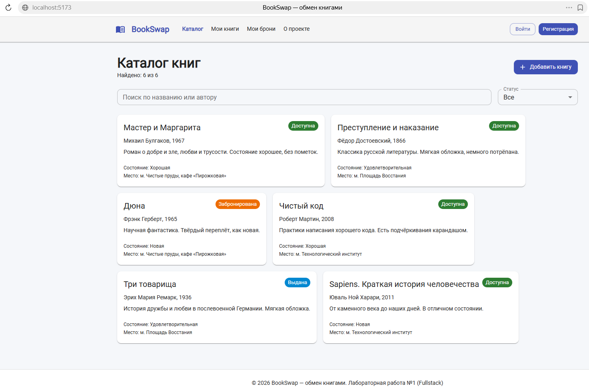
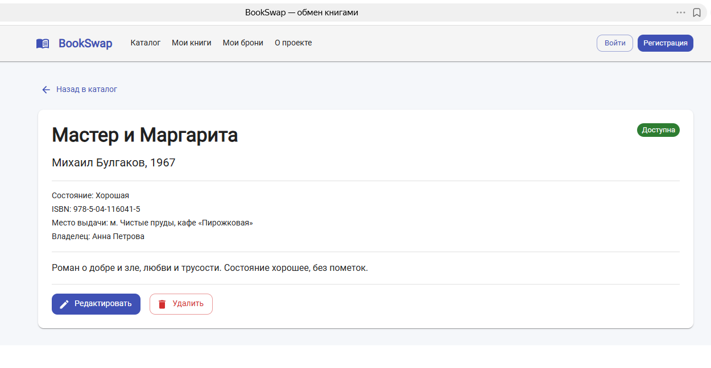
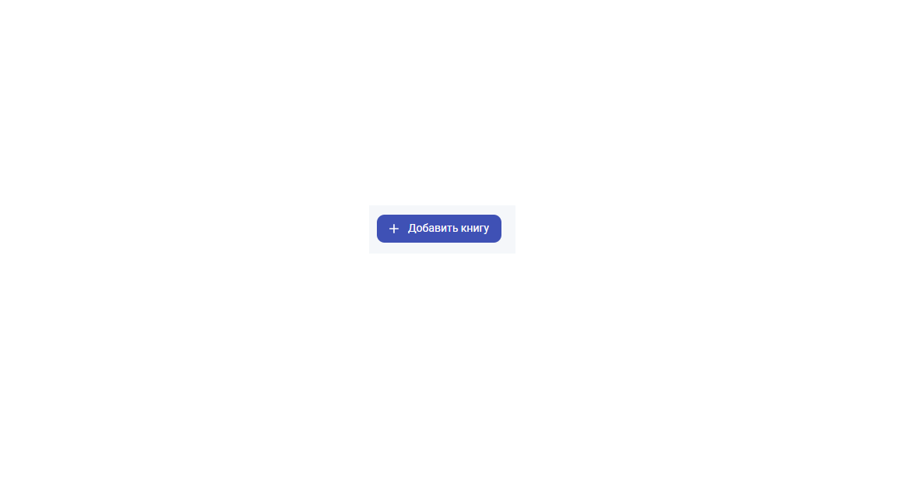
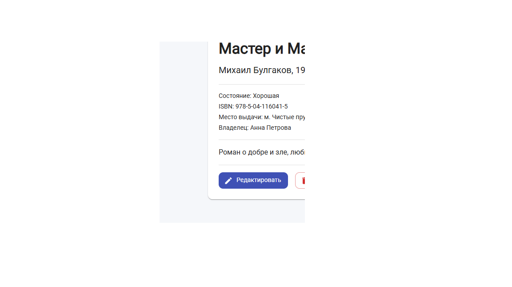
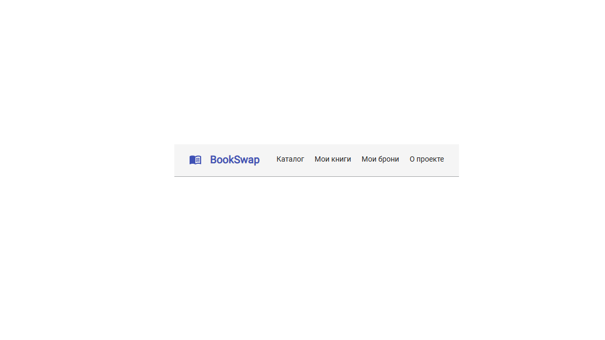
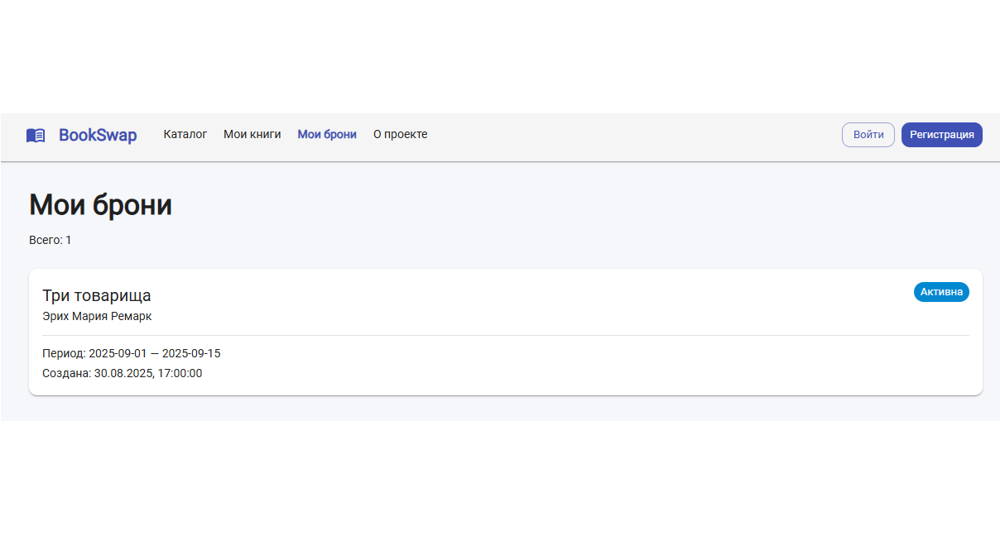
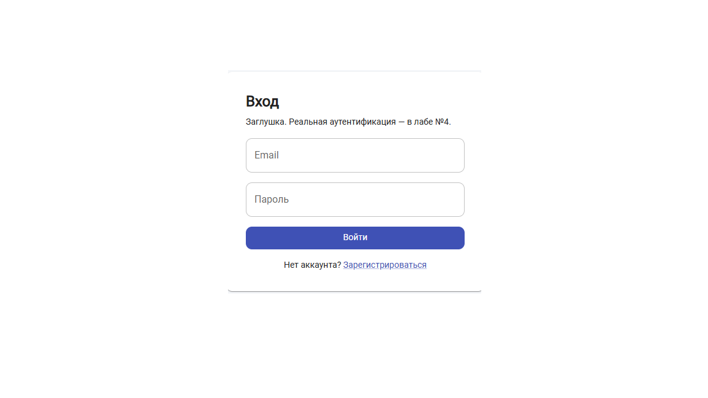
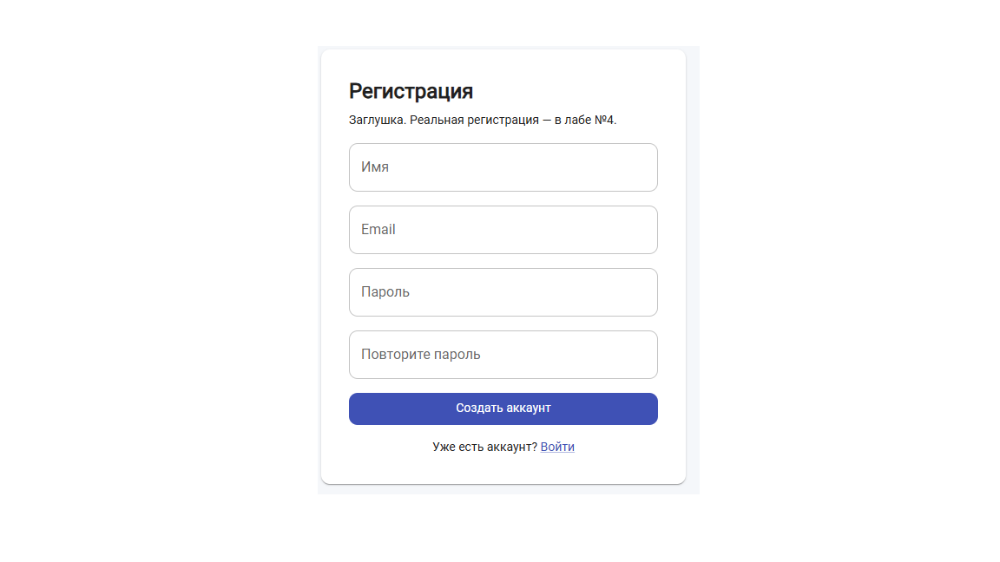
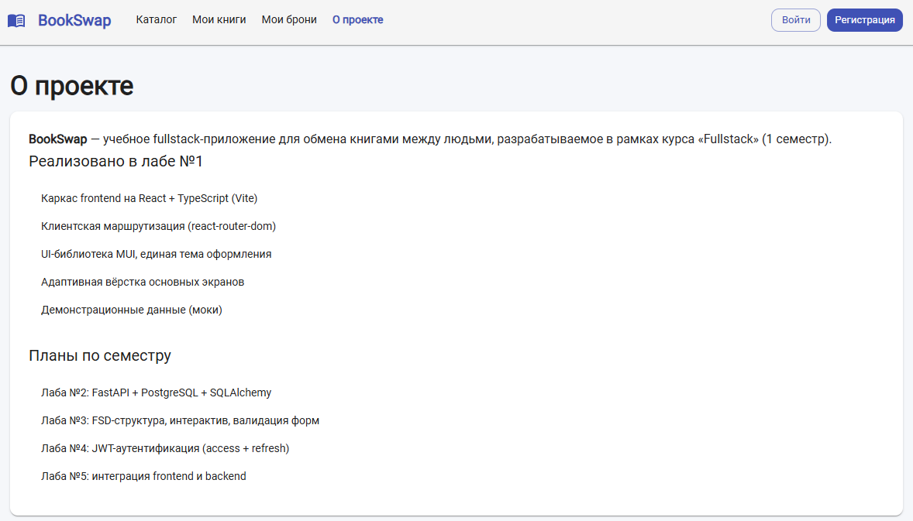

@"
# BookSwap — обмен книгами

Учебный fullstack-проект по курсу «Fullstack» (1 семестр).
Тема: платформа для обмена книгами между пользователями.

## Назначение

**BookSwap** — веб-приложение, где пользователи добавляют свои книги,
находят книги других людей и бронируют их на время.

## Пользовательские сценарии

1. Гость просматривает каталог книг, ищет по названию/автору, фильтрует по статусу.
2. Пользователь регистрируется и входит в приложение.
3. Пользователь добавляет свою книгу.
4. Владелец редактирует или удаляет свою книгу.
5. Другой пользователь открывает карточку книги и создаёт бронь на даты.
6. Пользователь видит список своих книг и своих броней.
7. По возврате книги бронь закрывается, книга снова доступна.

## Экраны

| Маршрут | Назначение | Доступ |
|---|---|---|
| / | Каталог книг (главная) | все |
| /books/:id | Детали книги | все |
| /books/new | Добавить книгу | авторизован |
| /books/:id/edit | Редактировать книгу | владелец |
| /my/books | Мои книги | авторизован |
| /my/bookings | Мои брони | авторизован |
| /bookings/new?bookId=... | Создать бронь | авторизован |
| /login | Вход | гость |
| /register | Регистрация | гость |
| /about | О проекте | все |
| * | 404 — страница не найдена | все |

## Технологии

**Frontend (лаба №1):**
- React 18 + TypeScript
- Vite
- React Router v6
- MUI (Material UI)

**Backend (лаба №2):**
- Python 3.12 + FastAPI
- PostgreSQL + SQLAlchemy
- Драйвер psycopg

## Структура проекта

book-swap/
├── backend/               # Серверная часть (лаба №2)
│   ├── app/
│   │   ├── crud/          # Функции для работы с БД
│   │   ├── schemas/       # Pydantic-схемы валидации
│   │   ├── api.py         # Маршруты API
│   │   ├── config.py      # Настройки подключения
│   │   ├── database.py    # Подключение к PostgreSQL
│   │   ├── main.py        # Точка входа FastAPI
│   │   └── models.py      # Модели SQLAlchemy
│   ├── .env.example       # Пример переменных окружения
│   └── create_tables.py   # Скрипт создания таблиц
├── docs/
│   └── screenshots/       # Скриншоты экранов и API
├── src/                   # Фронтенд (лаба №1)
│   ├── app/
│   ├── components/
│   ├── mocks/
│   ├── pages/
│   └── types/
├── .gitignore
├── package.json
└── README.md

## Запуск проекта

### Frontend
Требуется Node.js 20+ и npm.
npm install
npm run dev
Приложение будет доступно по адресу: http://localhost:5173

### Backend
Требуется Python 3.11+ и PostgreSQL.

1. Создать виртуальное окружение: python -m venv venv
2. Активировать: .\venv\Scripts\activate
3. Установить зависимости: pip install fastapi uvicorn sqlalchemy psycopg[binary] pydantic-settings
4. Создать в backend файл .env на основе .env.example.
5. Создать таблицы: python create_tables.py
6. Запустить сервер: uvicorn app.main:app --reload

- Swagger UI доступен по адресу: http://localhost:8000/docs

## Модель данных (лаба №2)

- User: id, name, email, password_hash.
- Book: id, title, author, year, isbn, description, condition, status, pickup_point, owner_id.
- Booking: id, start_date, end_date, status, book_id, borrower_id.

## Реализованные API-маршруты (лаба №2)

| Метод | Маршрут | Назначение |
|---|---|---|
| GET | /api/books/ | Список книг |
| POST | /api/books/ | Создать книгу |
| GET | /api/books/{book_id} | Получить книгу по ID |
| PUT | /api/books/{book_id} | Обновить книгу |
| DELETE | /api/books/{book_id} | Удалить книгу |
| POST | /api/bookings/ | Создать бронь |
| GET | /api/bookings/my | Мои брони |

## Скриншоты

### Лаба №1 (Frontend)

### Лаба №2 (Backend API)

## История изменений

- **v1 (лаба №1):** создан каркас React + TypeScript на Vite, настроена клиентская маршрутизация, подключена UI-библиотека MUI, реализованы все основные экраны на демонстрационных данных.
- **v2 (лаба №2):** реализован backend на FastAPI, подключена база данных PostgreSQL через SQLAlchemy, написаны CRUD-операции и API-маршруты.
